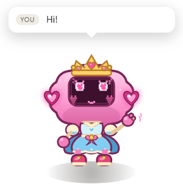

# buffy

A small companion that lives on your desktop and reacts to whatever your coding
agent is doing. Built so that Claude Code, Freebuff and anything else that can
run a shell command can drive the same pet.

<p align="center">
  
</p>

<p align="center">
  <a href="https://slayyyyer.github.io/buffy/"><strong>Website</strong></a> ·
  <a href="https://github.com/slayyyyer/buffy/releases/latest">Windows installer</a> ·
  <a href="https://github.com/slayyyyer/buffy#readme">Source</a>
</p>

```
Claude Code ──hooks──────────┐
Freebuff ──AGENTS.md events──┤
repo edits ──watcher─────────┼──► HTTP 127.0.0.1:4517 ──► daemon ──► ~/.buffy/state.json
a script ──buffy─────────────┘                              │
                                                            └──► overlay window (Electron)
```

The watcher is the dependable signal; Freebuff's AGENTS.md events are
best-effort.

The pet is not a chatbot. Agents only send events; the daemon owns the state and
the always-on-top overlay draws it.

## Status

Steps 1–4 of five are implemented:

- [x] daemon, CLI, state machine, placeholder sprite, overlay window
- [x] Claude Code hooks, `/buffy` command and `buffy install claude`
- [x] Freebuff repo watcher (dependable) and best-effort AGENTS.md events
- [x] `buffy hatch` with generated sprites
- [ ] polish (richer bubbles, multi-session arbitration)

## Requirements

- Node.js 20+ to run from source or use the CLI
- Windows, macOS or Linux with a desktop session (the overlay is an Electron window)
- Git is recommended for the repo watcher

## Install and run

### Desktop installer

**Windows 10/11 (x64):** [Download Buffy 0.1.0](https://github.com/slayyyyer/buffy/releases/download/v0.1.0/Buffy-0.1.0-win-x64.exe)
([SHA-256](https://github.com/slayyyyer/buffy/releases/download/v0.1.0/Buffy-0.1.0-win-x64.exe.sha256)).

This build is unsigned, so Windows SmartScreen will warn. The installer includes
the desktop app and starts its local daemon automatically; the pet itself does
not need Node installed. The `buffy` CLI, Claude Code hooks, and Freebuff
instructions still run from the Node checkout described below.

Only the Windows package is prebuilt. Build macOS and Linux installers on their
target operating systems with electron-builder:

```bash
npm install
npm run dist:win     # Windows NSIS installer in dist/
npm run dist:mac     # macOS dmg; build on macOS
npm run dist:linux   # Linux AppImage; build on Linux
```

macOS builds are unsigned too and may require right-clicking the app and choosing
**Open** unless you add a signing identity. The landing page lives in `docs/` and
is published at [slayyyyer.github.io/buffy](https://slayyyyer.github.io/buffy/) via
GitHub Pages.

### From source

```bash
npm install          # installs Electron

# optional: put `buffy` on your PATH
npm link

buffy overlay        # starts the daemon on demand and shows the pet
```

The overlay is frameless, transparent and always on top. Drag it anywhere for a
tiny heart-and-sparkle trail, click the pet to wave, right-click for the menu
(wardrobe, move to a screen corner, hide for 10 minutes, quit). Her eyes follow
your cursor, and she naps after 30 seconds of quiet idle; hover or click to wake
her. Her position is remembered in `~/.buffy/window.json`.

Use the **Wardrobe** menu to change her bow, hat, wand, and pastel theme. Those
choices are saved in `~/.buffy/wardrobe.json`.

Drive it from a second terminal:

```bash
buffy event thinking --msg "reading the repo" --source claude
buffy event working  --msg "editing src/app.ts" --source freebuff
buffy event needs-you --msg "waiting on a decision" --source claude
buffy event done     --msg "tests pass"
buffy pet
buffy status
```

Without `npm link`, use `node bin/buffy.js …` in place of `buffy`.

## Commands

| Command | Purpose |
| --- | --- |
| `buffy daemon` | Run the daemon in the foreground |
| `buffy event <state> [--msg "text"] [--source name]` | Send a state change; `--source` shows in the bubble |
| `buffy pet` | Happy reaction, +2 XP, +8 mood |
| `buffy status [--json]` | State, mood, XP, daemon health |
| `buffy overlay [--dev] [--shot file.png]` | Show the pet window |
| `buffy hatch "<prompt>"` | Generate a custom sprite with OpenAI Images (needs `OPENAI_API_KEY`) |
| `buffy install claude [--global]` | Merge Claude Code hooks and the `/buffy` command |
| `buffy uninstall claude [--global]` | Remove only buffy-managed entries |
| `buffy install freebuff` | Add best-effort event instructions to the project's `AGENTS.md` |
| `buffy uninstall freebuff` | Remove only the buffy block from `AGENTS.md` |

## Claude Code

```bash
buffy overlay          # start the pet
buffy install claude   # project scope: .claude/settings.json + .claude/commands/buffy.md
```

`install claude` merges five hooks into `.claude/settings.json` and never removes
an existing hook. Any file it changes is backed up next to itself as
`<name>.buffy-backup-<timestamp>`, and every install is recorded in
`~/.buffy/installs.json`.

| Claude Code event | Pet state | Bubble |
| --- | --- | --- |
| `UserPromptSubmit` | `thinking` | thinking about your prompt |
| `PreToolUse` | `working` | using <tool> |
| `PostToolUse` | `working` | <tool> finished |
| `Notification` (permission, idle, needs-input, elicitation) | `needs-you` | the notification message |
| `Stop` | `done` | turn finished |

Inside Claude Code, use `/buffy`, `/buffy status`, `/buffy pet`, or
`/buffy hatch "<prompt>"`. The command runs the CLI at its absolute installed
path, so it works even when `buffy` is not on your PATH.

`--global` writes `~/.claude/settings.json` and `~/.claude/commands/buffy.md`,
which applies to every Claude Code project on the machine. Project scope is the
default. Remove either with `buffy uninstall claude [--global]`.

## Freebuff

Current Freebuff (npm `0.2.36`, SDK `0.10.7`) has no user-installable lifecycle
hooks: there is no hook file in the shipped package, and the `cli/`, `sdk/` and
`docs/` trees have no hook-event API. What it does have:

- `AGENTS.md` (or `CLAUDE.md`) as a knowledge file, read from the project root.
- MCP servers from `.agents/mcp.json` in the project, its parent, or `~/.agents`.
- `handleEvent` on `@codebuff/sdk` runs — only for sessions started through the
  SDK, not a normal `freebuff` TUI session.

So buffy uses one dependable signal and one best-effort signal. The watcher
does not depend on the agent following instructions.

**Repo watcher (primary, dependable).** The daemon watches the working
directory for file churn and, when the directory is a git repository, polls
`git status` as well.
Churn sends `working`; `quietMs` without a change sends `done` and the pet
returns to idle. The git poll catches index-only changes such as `git add` or a
branch switch that never touch a working-tree file.

```json
{
  "watch": {
    "enabled": true,
    "directory": null,
    "quietMs": 2500,
    "pollMs": 700,
    "ignore": ["node_modules", ".git", "dist", "build", ".next", "artifacts"]
  }
}
```

`directory: null` means the directory the daemon was started in. The daemon is
shared across commands, so set an explicit directory if you switch projects.
`buffy status` prints the watched directory, whether git polling is active, and
the quiet window. `enabled: false` turns the watcher off.

**AGENTS.md instructions (secondary, best-effort).** `buffy install freebuff`
appends a marked block to the project's `AGENTS.md`. It asks the agent to send
`thinking` at the start, `working` before project-changing steps, `needs-you`
before it stops for input, and `done` when it finishes.

These are instructions, not hooks. Freebuff can ignore them: across four real
Desktop sessions the events varied — one sent `needs-you` and `done`, one sent
nothing, one sent `working` and `done`, and one refused an explicitly requested
`thinking` command but still sent `done`. `thinking` was never observed.

Only watcher-driven states are dependable: its `working` event and its
quiet-window `done`. Every event that depends on Freebuff reading or obeying
AGENTS.md is best-effort and may not occur, even when the command is written
out explicitly. Existing content is preserved, the file is backed up before the
first change, and repeated installs replace only the block.

```bash
buffy overlay
buffy install freebuff
```

The block uses the CLI's absolute path, so it works without `npm link`. Remove
it with `buffy uninstall freebuff`; the watcher is independent and keeps
working.

## Hatching a sprite

`buffy hatch` generates a transparent PNG from your description with OpenAI
Images, stores it in `~/.buffy/sprites/`, and swaps it into the running pet.
The overlay keeps its bob, tilt, squash and effects; the generated art replaces
the procedural body. The placeholder remains the fallback.

Set the key in the shell that runs hatch (buffy never stores or prints it):

```powershell
$env:OPENAI_API_KEY = "sk-..."
buffy hatch "a sleepy mint-colored axolotl with tiny antennae"
```

```bash
export OPENAI_API_KEY="sk-..."
buffy hatch "a sleepy mint-colored axolotl with tiny antennae"
```

Each hatch is one Images API call, billed to your OpenAI account. The prompt is
augmented with constraints for a single full-body character, transparent
background, and readability at about 100 px. If the daemon is running the
overlay updates immediately; otherwise the next `buffy overlay` shows it.

Configure the provider under `hatch` in `~/.buffy/config.json`:

```json
{
  "hatch": {
    "provider": "openai",
    "model": "gpt-image-1",
    "size": "1024x1024",
    "quality": "medium",
    "baseUrl": "https://api.openai.com/v1"
  }
}
```

`baseUrl` can point at an OpenAI-compatible image endpoint; the key env var is
still `OPENAI_API_KEY`.

## States

| State | Animation | Leaves when |
| --- | --- | --- |
| `idle` | slow breathing, blinking | any event |
| `thinking` | tilt, floating dots | any event |
| `working` | fast typing on a tiny keyboard | any event |
| `needs-you` | bouncing, wide eyes | another event arrives |
| `done` | hops and sparkles | after 4s, falls back to `idle` |
| `error` | shake, crossed eyes | another event arrives |

Last event wins. Every event carries a `source` (`claude`, `freebuff`, `watcher`,
`cli`, …) that is shown in the speech bubble.

## Configuration

`~/.buffy/config.json` is optional; defaults are shown.

```json
{
  "port": 4517,
  "doneHoldMs": 4000,
  "watch": {
    "enabled": true,
    "directory": null,
    "quietMs": 2500,
    "pollMs": 700,
    "ignore": [
      "node_modules", ".git", "dist", "build", "out", ".next", ".turbo",
      ".cache", "target", "coverage", "artifacts", ".buffy",
      "*.buffy-backup-*"
    ]
  },
  "hatch": {
    "provider": "openai",
    "model": "gpt-image-1",
    "size": "1024x1024",
    "quality": "medium",
    "baseUrl": "https://api.openai.com/v1"
  }
}
```

`BUFFY_PORT` overrides the port for one process. `BUFFY_HOME` relocates all
state (used by the tests).

## Files

| Path | Contents |
| --- | --- |
| `~/.buffy/state.json` | pet identity, sprite, mood, XP, counters |
| `~/.buffy/config.json` | port, timing, watcher and hatch settings |
| `~/.buffy/runtime.json` | daemon pid/port while it runs |
| `~/.buffy/window.json` | overlay position |
| `~/.buffy/installs.json` | installer manifest (scope, files, backups) |
| `~/.buffy/sprites/` | generated hatch PNGs |

## Security and privacy

- The daemon binds to `127.0.0.1` only.
- No telemetry. The only outbound request is `buffy hatch`, which sends your
  prompt to the configured image API using `OPENAI_API_KEY`; the key is read
  from the environment, never written to `~/.buffy` or the repo.
- The watcher is local: `fs.watch` plus a periodic `git status`. It never reads
  file contents and does not send anything off the machine.
- Nothing outside `~/.buffy` is written until you run an installer, which backs
  up every file it changes and records it in `~/.buffy/installs.json`.

## Troubleshooting

- **Pet does not appear.** Run `buffy status`; if the daemon is offline, run
  `buffy daemon` in a terminal to see the error. Electron must be installed
  (`npm install`).
- **Port already in use.** Change `port` in `~/.buffy/config.json`.
- **`buffy: unknown state`.** Valid states are `idle`, `thinking`, `working`,
  `needs-you`, `done`, `error`.
- **Overlay is hidden.** Use `buffy overlay` again; the second launch focuses the
  existing window and quits itself.
- **Watcher does not react.** `buffy status` prints the watched directory and
  whether git polling is on. Set `watch.directory` explicitly if the daemon was
  started from another folder, or `watch.enabled: false` to turn it off.
- **Freebuff ignores AGENTS.md.** Start Freebuff from the project root (it loads
  `AGENTS.md` as a knowledge file there) and re-run `buffy install freebuff`
  after moving this checkout. The watcher still tracks edits, but start,
  approval and agent-reported finish events may be missing; they are
  best-effort.
- **Hatch says `OPENAI_API_KEY` is not set.** Export it in the same shell that
  runs `buffy hatch`; a new terminal does not keep environment variables.
- **Hatch returns 401 or 429.** Check the key's billing and quota. Do not paste
  the key into chat or a repository.
- **New sprite does not appear.** The daemon must be running to serve the PNG.
  Restart `buffy overlay`; confirm the file exists in `~/.buffy/sprites/`.

## Uninstall

Remove agent wiring with `buffy uninstall claude` (add `--global` for user
scope) and `buffy uninstall freebuff`, quit the overlay from its right-click
menu, then remove `~/.buffy` and this checkout (and `npm unlink buffy` if you
linked it).
