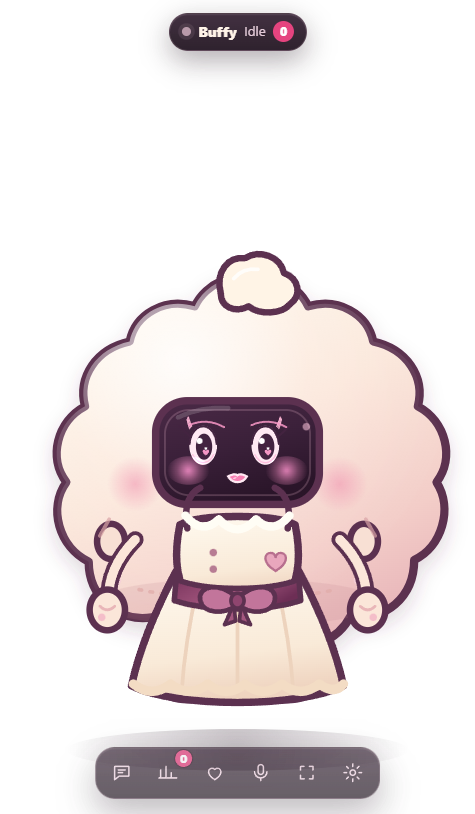
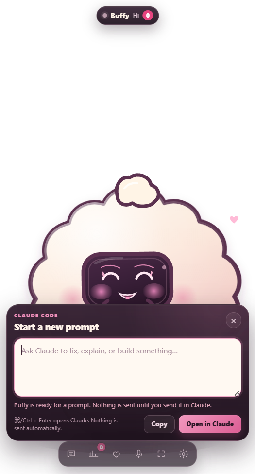
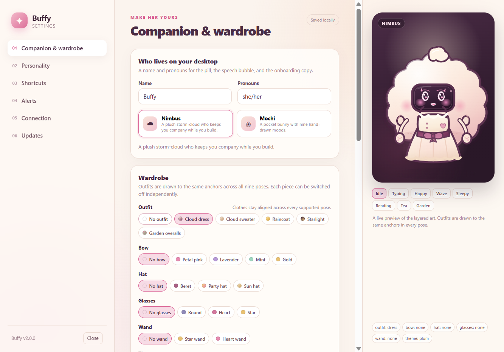

# buffy

A tiny always-on-top companion for Claude Code, Freebuff, and any coding agent
that can run a shell command. Buffy watches the work, keeps her own little
life, and can carry a prompt into Claude without sending it for you.

<p align="center">
  
</p>

<p align="center">
  <a href="https://slayyyyer.github.io/buffy/"><strong>Website</strong></a> ·
  <a href="https://github.com/slayyyyer/buffy/releases/latest">Windows installer</a> ·
  <a href="https://github.com/slayyyyer/buffy#readme">Source</a>
</p>

```
Claude Code ──hooks──────────┐
Freebuff ──AGENTS.md─────────┤
repo edits ──watcher─────────┼──► HTTP + SSE 127.0.0.1:4517 ──► daemon ──► ~/.buffy/state.json
a script ──buffy─────────────┘                                      │
                                                                    └──► Electron overlay + settings
```

Buffy is not a chatbot. Agents send events; the daemon owns the state and the
overlay draws it. Claude hooks are explicit. The Freebuff watcher is inferred
and labeled as such.

## Status

Buffy is at **v2.1.0**. The 2.0 line rebuilt the companion around an
asset-driven character system and a request-aware session model; 2.1 adds a
real size control:

- [x] Buffy's layered artwork and Mochi's nine-pose atlas, rendered by one engine
- [x] poses: idle, typing left/right, happy, wave, sleepy, reading, tea, gardening
- [x] full composer for Claude with draft-safe `claude://` handoff
- [x] request-aware concurrent sessions with pending badges that only count requests
- [x] three lifecycles: 30s completion presentation, 5m recent completions, 30m stale sessions
- [x] six-section settings window with live preview, wardrobe, alerts, connection, updates
- [x] per-character wardrobe, independent clothing switches, favorites, 32 saved looks
- [x] opt-in daily rotation that starts the next local day and skips unavailable art
- [x] default-off request/completion notifications, sounds, and 15m/1h/4h snooze
- [x] packaged Claude hook installer with a stable launcher and health distinctions
- [x] draft-aware update guard and explicit deferred-update resume
- [x] local-only dictation surfaced honestly; no cloud fallback is used

### 2.1.0

- **She comes in more sizes.** The old 80/100/125% steps are now Small,
Medium, Large, Extra large (150%), and Huge (175%). Choose one in
**Settings → Companion & wardrobe → Size**, or from the new **Size** submenu on
the right-click and tray menus.
- **Small now shrinks the whole window.** The 80% step only applied to compact
mode before, so picking Small left the full window unchanged. Every mode scales
with the chosen size now.
- **A size that does not fit is refused.** Instead of letting her hang off the
screen, Buffy rejects a size whose resting window is larger than the display and
leaves the choices that do fit enabled. The composer and activity panels are
clamped to the work area so a large size cannot lock you out of them.

### 2.0.2

- **She answers to Buffy, only.** The character was still called Nimbus in the
manifest, the built-in looks, the settings defaults and the docs. The character
id, asset folder and preferences key are now `buffy`, and saved wardrobes,
favorite looks, and rotation settings carry over from the old key on first load.
- **A new icon.** The app, tray, and site icons are rendered from her current
layered art instead of the pre-2.0 pink cloud with the crown.

### 2.0.1

- **Dragging no longer makes her grow.** The overlay captures its size once when
a drag starts instead of re-applying bounds on every pointer event, which
Windows was rounding up at display scales above 100%.
- **The status pill sits above her head.** While idle, the overlay measures the
topmost drawn pixel of the current character and art and hangs the pill 8px
above it, so hats, bows, and custom sprites no longer collide with it.

## Requirements

- Node.js 20+ to run from source or use the CLI
- Windows, macOS or Linux with a desktop session (the overlay is Electron)
- Git is recommended for the Freebuff watcher

## Install and run

### Desktop installer

Buffy **2.1.0** ships for Windows, macOS, and Linux:

- **Windows 10/11 (x64):** [installer](https://github.com/slayyyyer/buffy/releases/download/v2.1.0/Buffy-2.1.0-win-x64.exe) · [SHA-256](https://github.com/slayyyyer/buffy/releases/download/v2.1.0/Buffy-2.1.0-win-x64.exe.sha256)
- **macOS Apple silicon:** [dmg](https://github.com/slayyyyer/buffy/releases/download/v2.1.0/Buffy-2.1.0-mac-arm64.dmg) · [SHA-256](https://github.com/slayyyyer/buffy/releases/download/v2.1.0/Buffy-2.1.0-mac-arm64.dmg.sha256)
- **macOS Intel:** [dmg](https://github.com/slayyyyer/buffy/releases/download/v2.1.0/Buffy-2.1.0-mac-x64.dmg) · [SHA-256](https://github.com/slayyyyer/buffy/releases/download/v2.1.0/Buffy-2.1.0-mac-x64.dmg.sha256)
- **Linux x64:** [AppImage](https://github.com/slayyyyer/buffy/releases/download/v2.1.0/Buffy-2.1.0-linux-x86_64.AppImage) · [SHA-256](https://github.com/slayyyyer/buffy/releases/download/v2.1.0/Buffy-2.1.0-linux-x86_64.AppImage.sha256)

The packaged app includes the pet, the local daemon, and stable hook and CLI
launchers, so Claude Code does **not** need a Node checkout. Open **Settings →
Connection** to install or repair the hooks and the `/buffy` command. Only the
optional `buffy` terminal CLI runs from the source checkout.

Builds are unsigned unless signing credentials are configured, so Windows
SmartScreen and macOS Gatekeeper may ask you to confirm. See
[Release signing](#release-signing).

### From source

```bash
npm install          # installs Electron
npm link             # optional: put `buffy` on your PATH
buffy overlay        # starts the daemon on demand and shows Buffy
```

The overlay is frameless, transparent, and always on top. Drag the character
to move her, click her to pet her, right-click for the menu, and use the pill
toolbar for compose, activity, wardrobe, compact mode, and settings.

The first-run setup window explains the overlay, the global shortcut, the
Claude connection, and where state lives. Reopen it from the tray or with
`buffy overlay --onboarding`.

<p align="center">
  
</p>

## Compose for Claude

Buffy's composer is a draft tray, not a send button with a text field.

- The default global shortcut is **Ctrl/Cmd + Shift + B**. Change it in
  **Settings → Shortcuts**. If the accelerator is already taken, Buffy reports
  the conflict and keeps the previous shortcut; it never silently falls back.
- Summoning reveals the overlay, expands the composer, places it near the
  pointer when hidden, and focuses the existing draft without recording or
  sending anything.
- **Ctrl/Cmd + Enter** hands the draft to Claude. Buffy opens
  `claude://code/new?q=<encoded>` through the OS.
- Unicode, newlines, and literal `+` survive encoding.
- The handoff is deliberately capped at **4,000 encoded URL characters**. A
  longer draft is rejected with a copy fallback; it is never truncated.
- Buffy logs no prompt-bearing URL. A successful OS launch only proves the link
  was handed to the operating system; Claude still shows the prompt for review.
- Drafts live in the main process, not on disk. Hiding, compact mode, settings,
  failed opens, and window resizes preserve the draft. It clears only after a
  successful handoff if the revision has not changed in the meantime.
- **Escape** closes the panel and asks the OS to restore focus where supported.
- Update prompts never interrupt an open composer, a non-empty draft, or an
  in-flight handoff.

<p align="center">
  
</p>

## Characters, wardrobe, and poses

Buffy uses an asset-driven character system. A character is either layered
(base + outfit + accessory layers + semantic pose art) or an atlas with one
cell per pose. The overlay, wardrobe preview, and settings preview all use the
same renderer.

**Buffy** is the plush storm-cloud, drawn as layered SVG. **Mochi** is
a pocket bunny with a 3×3 atlas and exercises the atlas path. Both support:

`idle` · `typingLeft` · `typingRight` · `happy` · `wave` · `sleepy` · `reading` · `tea` · `gardening`

Open **Settings → Companion & wardrobe** to:

- choose a character and preview every pose
- change name and pronouns
- mix outfits, bows, hats, glasses, wands, and themes
- switch each clothing slot off without deleting the underlying look
- wear built-in looks or save your own (up to **32 per character**)
- favorite looks, rename/replace/delete saved looks, and choose which saved looks
  participate in rotation
- use **Surprise me**, with a gentle bias toward favorites

Clothing selections are stored per character. Unavailable art is disabled in
the choice list rather than silently deleting a saved selection.

<p align="center">
  
</p>

### Daily rotation

Rotation is opt-in per character and starts on the **next local day**, not the
day you enable it. It only runs while resting. An open composer, activity cards,
an open settings window, a handoff, or a drag defers the change. A manual look
change on a local day prevents a reroll that day, and a restart does not reroll
a day that already rotated. Unavailable assets are skipped without consuming
the day or deleting the look.

## Sessions and lifecycles

Every agent event belongs to a session. Claude hooks use the payload
`session_id`; the watcher has its own session; CLI callers can pass
`--session <id>` or set `BUFFY_SESSION`.

The visible state is the highest-priority active session:

`needs-you` > `error` > `working` > `thinking` > `done` > `idle`

Requests are tracked separately from session state:

- A permission request or question has a stable request id, or a stable
  fingerprint when the hook has no id.
- Unrelated parallel tool completions cannot clear a request.
- A matching request id, tool-use id, or safe fingerprint/tool-name match
  resolves it. Session end clears only that session's requests.
- An idle reminder is informational. It never dismisses a request or wipes a
  recent completion.
- The pending badge counts **unresolved requests only**, not "done" animations.

Three lifecycles are intentionally separate:

| Lifecycle | Default | What it means |
| --- | --- | --- |
| Completion presentation | 30 seconds | `done` hop/sparkles before the pet returns to idle |
| Recent completions | 5 minutes | Activity cards can still show what finished |
| Stale session expiry | 30 minutes | Quiet sessions are removed |

These are configurable with `doneHoldMs` and `sessionTtlMs` in
`~/.buffy/config.json`.

## Personality and quiet time

**Settings → Personality** controls idle hobbies, extra gestures, return
greetings, sleepiness, thought bubbles (Off / Emoji / Emoji + words), reduced
motion, and reply reactions. Reply reactions are **off by default** and only use
transient presentation categories. Decorations pause while composing,
recording, or showing activity cards. Settings previews are visual only and do
not trigger live reactions.

## Alerts

Request and completion notifications are **off by default**, as are sounds.
Enable them in **Settings → Alerts**. The first snapshot after startup seeds the
dedupe set, so old requests never burst out on launch. A snooze (15 minutes,
1 hour, or 4 hours) suppresses delivery but still marks events seen; they are
never replayed later. Idle reminders do not create request alerts, and inferred
completion events never create completion notifications.

## Settings

The settings window has six sections:

1. **Companion & wardrobe** — identity, character, clothing, saved looks, rotation
2. **Personality** — hobbies, gestures, sleep, bubbles, motion, reactions
3. **Shortcuts** — global summon shortcut and conflict status
4. **Alerts** — request/completion/sound switches and snooze
5. **Connection** — Claude hook health, Freebuff watcher, daemon status, dictation
6. **Updates** — current version, update check, install guard

The right-hand preview draws the current character at full size with selectable
poses, so wardrobe changes are visible before you leave settings.

## Claude Code

Use **Settings → Connection → Connect Claude Code** in the packaged app. It
writes a stable launcher to `~/.buffy/bin/buffy-hook.cmd` (Windows) or
`~/.buffy/bin/buffy-hook` (macOS/Linux), then merges hooks into the **user**
Claude settings (`~/.claude/settings.json`). The launcher runs the packaged
Electron binary in Node mode and survives app updates. It also writes
`~/.buffy/bin/buffy-cli.cmd` / `buffy-cli` for the `/buffy` command, so the
slash command works without a checkout too.

From a source checkout, the equivalent is:

```bash
buffy install claude --global
# or project scope:
buffy install claude
```

The installer:

- preserves unrelated hooks and settings
- backs up every changed file as `<name>.buffy-backup-<timestamp>`
- writes atomically and restores the prior settings if the command file fails
- respects Claude's `disableAllHooks` and refuses to claim a connection when
  hooks are disabled
- records the install in `~/.buffy/installs.json`
- never blocks the agent: a hook always exits 0 and writes diagnostics only to
  stderr

The installed hook vocabulary:

| Claude Code event | Buffy behavior |
| --- | --- |
| `SessionStart` | session visibility |
| `UserPromptSubmit` | thinking |
| `PreToolUse` | working, with a tool category |
| `PermissionRequest` | explicit permission request |
| `PostToolUse` | working; resolves matching requests |
| `PostToolUseFailure` | error |
| `Notification` | question/permission request, or informational idle reminder |
| `PreCompact` / `PostCompact` | compacting |
| `SubagentStop` | delegating finished |
| `Stop` | explicit completion |
| `SessionEnd` | session ended; clears its requests |

The settings page distinguishes **not connected**, **installed but no event
seen**, **repair needed**, **hooks disabled**, **connected** (a hook event was
seen within 30 minutes), and **error**. Installation alone is not reported as a
verified connection.

## Freebuff

Freebuff has no user-installable lifecycle hook stream. Buffy uses two signals:

- **Repo watcher (dependable):** file churn sends `working`; a quiet window
  sends `done` with category `settled-inferred` and message `activity settled`.
  It never claims a test passed or that work succeeded.
- **AGENTS.md instructions (best-effort):** `buffy install freebuff` appends a
  marked block asking the agent to send thinking/working/needs-you/done events.
  Agents can ignore it.

The watcher is local (`fs.watch` + a periodic `git status`) and does not read
file contents or upload anything. **Settings → Connection** can disable it; the
daemon restarts to apply the change.

## Dictation

Buffy only supports dictation when an on-device recognizer is available. This
build has no bundled dictation helper. On this Windows host it reports that
dictation is unavailable and keeps the text path fully usable; it never sends
audio to a cloud service as a fallback. The composer, clipboard fallback, and
keyboard shortcuts remain available.

## CLI

| Command | Purpose |
| --- | --- |
| `buffy daemon` | Run the local daemon in the foreground |
| `buffy event <state> [--msg "text"] [--source name] [--session id]` | Send a state change |
| `buffy pet` | Pet reaction, mood, and XP |
| `buffy dismiss <session>` | Clear one active session |
| `buffy status [--json]` | Current state, sessions, mood, XP, daemon health |
| `buffy overlay [--dev] [--onboarding] [--shot file.png]` | Show the overlay and optional setup |
| `buffy hatch "<prompt>"` | Generate a custom sprite with OpenAI Images |
| `buffy install claude [--global]` | Merge Claude hooks and `/buffy` |
| `buffy uninstall claude [--global]` | Remove Buffy-managed hooks only |
| `buffy install freebuff` | Add best-effort AGENTS.md instructions |
| `buffy uninstall freebuff` | Remove only the Buffy block |

States accepted by `buffy event`: `idle`, `thinking`, `working`, `needs-you`,
`done`, `error`.

## Files

| Path | Contents |
| --- | --- |
| `~/.buffy/preferences.json` | v3 identity, character looks, personality, shortcuts, alerts, connection, updates |
| `~/.buffy/state.json` | pet identity, sprite, mood, XP, counters |
| `~/.buffy/window.json` | full/compact positions and size (80–175% scale) |
| `~/.buffy/config.json` | port, timing, watcher, hatch settings |
| `~/.buffy/runtime.json` | daemon pid/port while running |
| `~/.buffy/onboarding.json` | first-run acknowledgement |
| `~/.buffy/installs.json` | installer manifest (scope, files, launcher, backups) |
| `~/.buffy/hook-last.json` | last hook event seen (health only) |
| `~/.buffy/bin/` | stable packaged hook launcher |
| `~/.buffy/sprites/` | generated hatch PNGs |

Legacy `~/.buffy/wardrobe.json` and `config.overlay` settings migrate into
`preferences.json`. Old `princess`/`sleepover` outfit ids map to `dress` and
`overalls`. Nothing is deleted.

## Configuration

`~/.buffy/config.json` is optional; defaults include:

```json
{
  "port": 4517,
  "doneHoldMs": 30000,
  "sessionTtlMs": 1800000,
  "watch": {
    "enabled": true,
    "directory": null,
    "quietMs": 2500,
    "pollMs": 700
  },
  "hatch": {
    "provider": "openai",
    "model": "gpt-image-1",
    "size": "1024x1024",
    "quality": "medium",
    "baseUrl": "https://api.openai.com/v1"
  }
}
```

`BUFFY_PORT` overrides the port for one process. `BUFFY_HOME` relocates all
state (used by tests). Preferences are edited through the settings window; the
main process normalizes them before every save.

## Hatching a sprite

`buffy hatch` generates a transparent PNG with OpenAI Images, stores it in
`~/.buffy/sprites/`, and swaps it into the running pet. The overlay keeps its
bob and state effects; the generated art replaces the layered body. A custom
sprite is a full-body replacement, so procedural outfits, accessories, and
hobby props are not drawn over it. Set `OPENAI_API_KEY` in the shell that runs
the command; the key is never written to Buffy state or logged.

## Security and privacy

- The daemon binds to `127.0.0.1` only and streams updates over SSE with a
  polling fallback.
- No telemetry.
- Installed builds check GitHub Releases for updates. The only other outbound
  request is `buffy hatch`, which sends the prompt to the configured image API
  using your `OPENAI_API_KEY`.
- The watcher is local and never reads file contents.
- The composer deliberately cannot send a prompt. It hands a URL to the OS and
  clears the draft only after a successful launch with no intervening edit.
- Prompt-bearing URLs are never written to logs.
- Dictation never falls back to a cloud service.

## Troubleshooting

- **Pet does not appear.** Run `buffy status`; if the daemon is offline, run
  `buffy daemon` in a terminal to see the error. Electron must be installed
  (`npm install`).
- **Port already in use.** Change `port` in `~/.buffy/config.json`.
- **Shortcut does nothing.** Open **Settings → Shortcuts**. A conflict with
  another app is reported there; choose a different accelerator.
- **Claude connection says installed but no event.** Start a Claude Code
  session. "Connected" requires an event within the last 30 minutes.
- **Hooks are disabled.** Claude's `disableAllHooks` is on. Buffy leaves the
  settings untouched and reports the disabled state.
- **Watcher does not react.** Check **Settings → Connection**; the watched
  directory is the daemon's working directory. Restart the daemon after
  changing the watcher switch or start it from the project root.
- **Update is waiting.** Finish or clear the draft, then use the tray or
  **Settings → Updates** to restart explicitly. Buffy does not install updates
  behind an open draft.
- **Dictation is unavailable.** This build has no on-device recognizer. Type,
  or use the clipboard fallback; no audio is uploaded.

## Release signing

The release workflow builds unsigned artifacts when optional secrets are
absent. To enable signing and notarization:

| Platform | Secrets |
| --- | --- |
| Windows | `WIN_CSC_LINK`, `WIN_CSC_KEY_PASSWORD` |
| macOS | `MAC_CSC_LINK`, `MAC_CSC_KEY_PASSWORD`, `APPLE_ID`, `APPLE_APP_SPECIFIC_PASSWORD`, `APPLE_TEAM_ID` |

macOS runs `build/notarize.cjs` after signing and skips notarization when the
Apple credentials are missing. Pushing a `v*` tag that matches `package.json`
builds the installers, smoke-tests each packaged app, writes checksums, and
uploads the `latest*.yml` update metadata. Build locally with:

```bash
npm run dist:win
npm run dist:mac
npm run dist:linux
```

## Verification

```bash
npm test                 # unit and integration coverage
npm start                # run the overlay from source
npx electron . --smoke-test --no-sandbox
npx electron . --shot docs/shots/overlay.png --shot-exit
npx electron . --shot docs/shots/settings.png --shot-mode settings --shot-exit
```

## Uninstall

Use **Settings → Connection → Remove hooks** or:

```bash
buffy uninstall claude --global
buffy uninstall freebuff
```

Turn off launch at login, quit Buffy from the tray, then remove `~/.buffy` and
the checkout (and `npm unlink buffy` if linked).

## License

MIT. The Blossom/Ensemble relay, inbox, badges, reactions, and mode features are
intentionally not part of Buffy; this is a local desktop companion.
